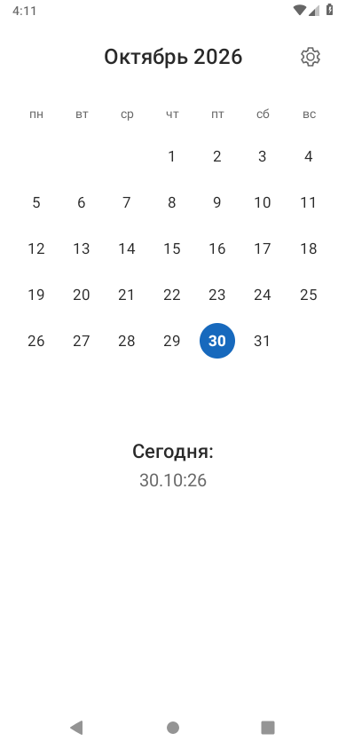
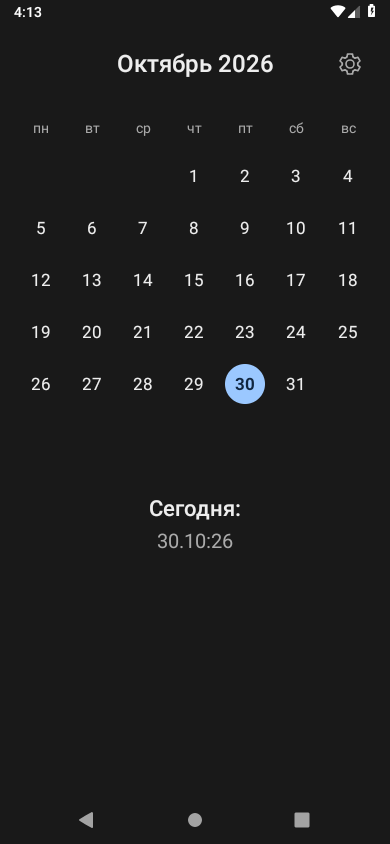

# Just a Calendar

**Месяц. Даты. Ничего лишнего.**

Маленький календарь для Android, сделанный для себя. Открыл, посмотрел дату,
перелистнул месяц, закрыл. Без событий, аккаунтов, синхронизации и прочего,
что здесь просто не нужно.

**Android 8.0+ · Светлая и тёмная темы · Полностью офлайн · MIT**

[Скачать APK](https://github.com/burmaldun6-ship-it/just-a-calendar/releases/latest) · [Как собрать](docs/BUILDING.md) · [Изменения](CHANGELOG.md)

<p align="center">
  
  &nbsp;&nbsp;
  
</p>

## Что умеет

- Показывать месяц, начиная с понедельника, и выделять сегодняшний день.
- Листать месяцы свайпом — никаких стрелок и лишних кнопок.
- Возвращаться к текущему месяцу по нажатию на **«Сегодня»**.
- Переключать светлую и тёмную темы через шестерёнку.
- Проверять смену даты раз в **1–60 секунд**: по умолчанию **5 секунд**,
  либо совсем отключать проверку по таймеру.

Под календарём — сегодняшняя дата в формате **`1.01:26`**:
день без ведущего нуля, месяц из двух цифр, короткий год.
Сетка всегда занимает шесть строк, поэтому блок «Сегодня» не прыгает.

Таймер работает только пока приложение активно. Даже если его отключить,
дата проверяется при возвращении в приложение и нажатии на «Сегодня».

## Установка

Откройте раздел **Releases** этого репозитория и скачайте APK из вложений
нужной версии, если релиз опубликован. Нужен **Android 8.0 или новее**.
Исходники не требуют Google Play Services.

> **Переход с 1.1 на 1.2:** подпись изменилась. Перед установкой 1.2 нужно удалить
> старое приложение; сохранённые настройки при этом сбросятся.

## Конфиденциальность

Приложение не запрашивает доступ к интернету, не содержит рекламы и аналитики.
Тема и настройки обновления сохраняются только локально. События календаря,
контакты, геолокация и учётные записи ему не нужны.

Резервное копирование отключено; дополнительно заданы исключения переноса
данных. Подробности и границы проверки — в [SECURITY.md](SECURITY.md).

## Собрать самому

Нужны **JDK 17**, **Android SDK 35** и **Build Tools 35.0.0**.
Gradle загружается через Wrapper. **NDK не нужен.**

Откройте корень проекта в Android Studio или настройте `JAVA_HOME`
и `ANDROID_HOME`, затем выполните:

```sh
# Тесты, Android Lint и оптимизированная release-сборка
./verify.sh

# Устанавливаемая отладочная сборка с локальной debug-подписью
./gradlew --dependency-verification strict assembleDebug
```

| Результат | Путь |
| --- | --- |
| Debug APK, можно установить | `app/build/outputs/apk/debug/app-debug.apk` |
| Release APK, ещё нужно подписать | `app/build/outputs/apk/release/app-release-unsigned.apk` |

Для Windows, настройки SDK и подписи смотрите [инструкцию сборки](docs/BUILDING.md).
Первой сборке нужен интернет; установленному приложению — нет.

## Внутри

Java, нативные Android View, AndroidX ViewPager2 и RecyclerView.
Без WebView, Compose и сетевых библиотек. В release включены R8,
удаление неиспользуемых ресурсов и словарь коротких имён `a–z`, `A–Z`.

В коде есть **8 unit-тестов** календарной логики и отдельный
[UI smoke-тест](docs/TESTING.md) для одноразового эмулятора.
GitHub Actions проверяет репозиторий, запускает тесты и Lint, собирает APK.

Это небольшой личный инструмент, а не комбайн с дорожной картой на три года.
Список изменений — в [CHANGELOG.md](CHANGELOG.md).

---

Сторонние компоненты перечислены в [THIRD_PARTY_NOTICES.md](THIRD_PARTY_NOTICES.md).

Распространяется под [лицензией MIT](LICENSE). Сделано для себя — можно пользоваться и дорабатывать.
